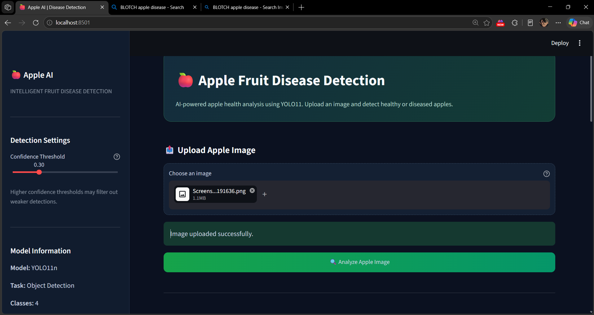
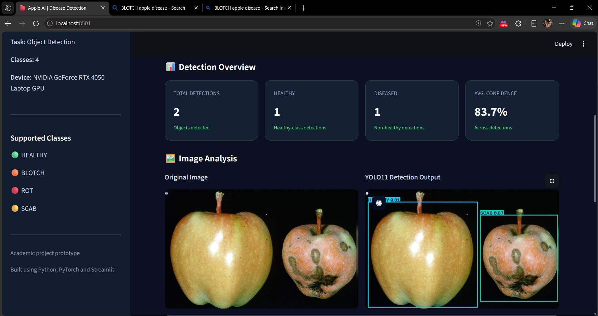
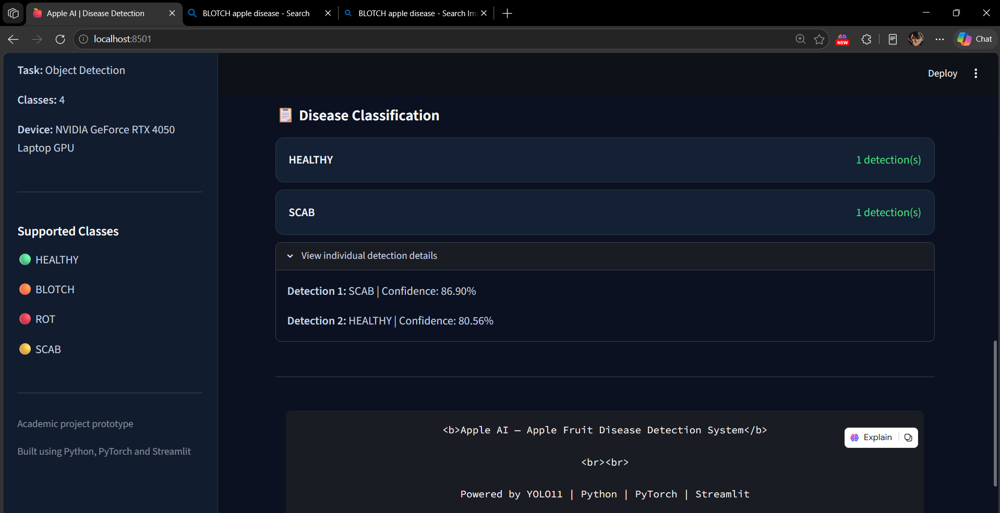

# 🍎 Apple Disease Detection Using YOLO11

An AI-powered apple fruit disease detection system developed using YOLO11, Python, and Streamlit.

## 📌 Project Overview

This project uses deep learning and computer vision to detect and classify apple fruit conditions from uploaded images.

The system identifies four categories:

- BLOTCH
- HEALTHY
- ROT
- SCAB

Users can upload an apple image through the Streamlit web application and view the detected classes, bounding boxes, and confidence scores.

## 🖥️ Application Screenshots

### 1. Main Dashboard


### 2. Healthy Apple Detection


### 3. Diseased Apple Detection


## ✨ Features

- YOLO11-based object detection.
- Four apple fruit categories.
- Image upload through Streamlit.
- Bounding boxes and confidence scores.
- Detection statistics.
- Original and annotated image comparison.
- Downloadable prediction results.

## 🧠 Model Performance

Validation results obtained during training:

| Metric | Result |
|---|---:|
| Precision | 92.8% |
| Recall | 90.0% |
| mAP50 | 95.9% |
| mAP50-95 | 79.3% |

*These are validation results, not independent test-set results.*

## 📂 Dataset

Dataset: [Apple Fruit Disease Detection – Roboflow](https://universe.roboflow.com/fruit-disease-detection-nrrei/apple-fruit-disease-detection-uqrc4/dataset/1)

| Split | Images |
|---|---:|
| Training | 912 |
| Validation | 87 |
| Testing | 43 |
| Total | 1,042 |

## 🛠️ Technologies Used

- Python
- YOLO11
- Ultralytics
- PyTorch
- OpenCV
- Streamlit
- NumPy
- Pillow

## ⚙️ Installation

Clone the repository:

```bash
git clone https://github.com/its-Kunal-fr/Apple-Disease-Detection.git
cd Apple-Disease-Detection
```

Create and activate a virtual environment:

```bash
python -m venv venv
venv\Scripts\activate
```

Install dependencies:

```bash
pip install -r requirements.txt
```

Run the application:

```bash
streamlit run app.py
```

Open the local URL shown in your terminal, usually `http://localhost:8501`.

## 🚀 Training

To train the model:

```bash
python train.py
```

To evaluate:

```bash
python evaluate.py
```

## ⚠️ Disclaimer

This project is an academic prototype. Predictions depend on image quality and dataset diversity and should not replace professional agricultural diagnosis.

## 👨‍💻 Author

GitHub: [its-Kunal-fr](https://github.com/its-Kunal-fr)

**Project:** Apple Disease Detection Using YOLO11
